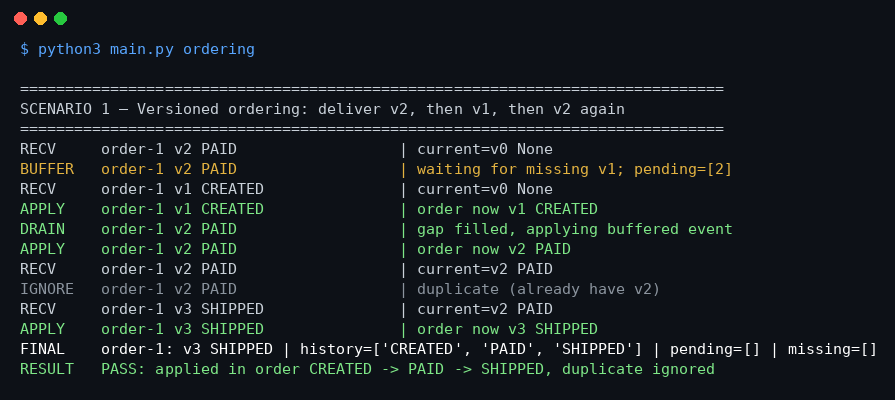
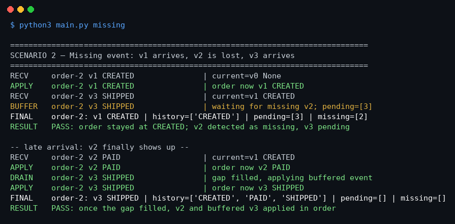
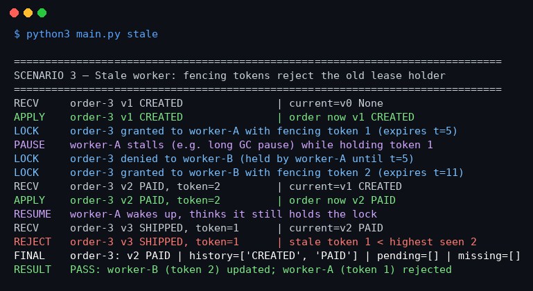
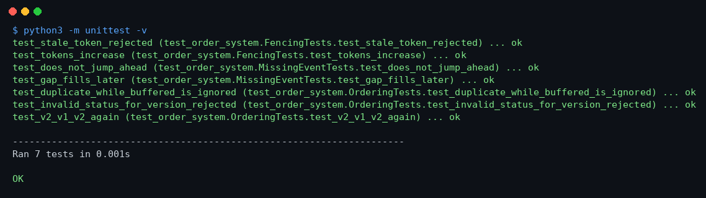

# Module 7 Assignment: Time, Ordering & Coordination

**CMPE 273 — Event Ordering, Delayed Messages & Stale Workers**

A small Python simulation of an order moving through versioned states:

```
v1 CREATED  →  v2 PAID  →  v3 SHIPPED
```

Events can arrive **late, out of order, or more than once**, and two workers can
race to update the same order. The system still ends up correct.

## How it works

| Problem | Mechanism | Where |
|---|---|---|
| Out-of-order delivery | Apply only `version == current + 1`; park early arrivals in a `pending` buffer, then drain it when the gap fills | `OrderStore.receive()` steps (d), (e) |
| Duplicates | Ignore any version `<= current` or already in `pending` | step (c) |
| Missing event | Gap detected and reported via `missing_versions()`; order never jumps ahead | step (d) |
| Stale worker | `LockService` hands out leases with increasing **fencing tokens**; the store remembers the highest token seen and rejects older ones | step (a) + `LockService` |

Every event carries `order_id`, `version`, `status` (and `fencing_token` when a worker sends it).

## Project layout

```
order_system.py        core: OrderEvent, OrderStore, LockService
main.py                runs the 3 required scenarios + a bonus chaos test
test_order_system.py   7 unit tests (stdlib unittest)
logs/run_output.txt    captured output of main.py
logs/test_output.txt   captured output of the unit tests
screenshots/           terminal screenshots
```

## Running it

Requires Python 3.8+. No third-party packages.

```bash
git clone https://github.com/Psinghvisen/Module-7-Assignment-Time-Ordering-Coordination.git
cd Module-7-Assignment-Time-Ordering-Coordination

python3 main.py                 # all scenarios
python3 main.py ordering        # one scenario: ordering | missing | stale | chaos
python3 -m unittest -v          # unit tests
```

Log prefixes: `RECV` event arrived · `APPLY` state changed · `BUFFER` early event parked ·
`DRAIN` buffered event applied after gap filled · `IGNORE` duplicate dropped · `REJECT` refused.

---

## 1. Correct event ordering (v2 → v1 → v2 again)

v2 arrives first and is **buffered**, since v1 is missing. When v1 arrives it is applied and
v2 is **drained** right after it. The second v2 is a **duplicate** and is ignored.

```
RECV     order-1 v2 PAID                  | current=v0 None
BUFFER   order-1 v2 PAID                  | waiting for missing v1; pending=[2]
RECV     order-1 v1 CREATED               | current=v0 None
APPLY    order-1 v1 CREATED               | order now v1 CREATED
DRAIN    order-1 v2 PAID                  | gap filled, applying buffered event
APPLY    order-1 v2 PAID                  | order now v2 PAID
RECV     order-1 v2 PAID                  | current=v2 PAID
IGNORE   order-1 v2 PAID                  | duplicate (already have v2)
RECV     order-1 v3 SHIPPED               | current=v2 PAID
APPLY    order-1 v3 SHIPPED               | order now v3 SHIPPED
FINAL    order-1: v3 SHIPPED | history=['CREATED', 'PAID', 'SHIPPED'] | pending=[] | missing=[]
RESULT   PASS: applied in order CREATED -> PAID -> SHIPPED, duplicate ignored
```



## 2. Duplicate handling

Covered in the log above (`IGNORE ... duplicate`), plus two unit tests:
- `test_v2_v1_v2_again`: the repeated v2 returns `DUPLICATE` and history stays `['CREATED', 'PAID']`
- `test_duplicate_while_buffered_is_ignored`: a duplicate of an event *still waiting in the buffer* is also dropped

The bonus chaos run delivers the three events in random order with up to 4 random duplicates,
1000 times. Every run ends at `CREATED -> PAID -> SHIPPED`:

```
RESULT   PASS: all 1000 random delivery orders converged to CREATED -> PAID -> SHIPPED
```

## 3. Missing-event case

v1 arrives, v2 is lost, v3 arrives. The order **stays at CREATED**: it doesn't jump to SHIPPED.
v2 is reported as missing and v3 is held as pending. When v2 finally shows up late, both apply in order.

```
RECV     order-2 v1 CREATED               | current=v0 None
APPLY    order-2 v1 CREATED               | order now v1 CREATED
RECV     order-2 v3 SHIPPED               | current=v1 CREATED
BUFFER   order-2 v3 SHIPPED               | waiting for missing v2; pending=[3]
FINAL    order-2: v1 CREATED | history=['CREATED'] | pending=[3] | missing=[2]
RESULT   PASS: order stayed at CREATED; v2 detected as missing, v3 pending

-- late arrival: v2 finally shows up --
RECV     order-2 v2 PAID                  | current=v1 CREATED
APPLY    order-2 v2 PAID                  | order now v2 PAID
DRAIN    order-2 v3 SHIPPED               | gap filled, applying buffered event
APPLY    order-2 v3 SHIPPED               | order now v3 SHIPPED
FINAL    order-2: v3 SHIPPED | history=['CREATED', 'PAID', 'SHIPPED'] | pending=[] | missing=[]
RESULT   PASS: once the gap filled, v2 and buffered v3 applied in order
```



## 4. Stale-worker rejection (fencing tokens)

Timeline (simulated clock, 5-second lease):

| t | Event |
|---|---|
| 0 | worker-A acquires the lock with **token 1**, then stalls (e.g. a long GC pause) |
| 2 | worker-B asks for the lock and is denied, because A's lease is still valid |
| 6 | A's lease has expired. worker-B gets **token 2** and writes `PAID` |
| 7 | worker-A wakes up, still thinks it owns the lock, and tries to write `SHIPPED` with token 1. **Rejected.** |

```
LOCK     order-3 granted to worker-A with fencing token 1 (expires t=5)
PAUSE    worker-A stalls (e.g. long GC pause) while holding token 1
LOCK     order-3 denied to worker-B (held by worker-A until t=5)
LOCK     order-3 granted to worker-B with fencing token 2 (expires t=11)
RECV     order-3 v2 PAID, token=2         | current=v1 CREATED
APPLY    order-3 v2 PAID, token=2         | order now v2 PAID
RESUME   worker-A wakes up, thinks it still holds the lock
RECV     order-3 v3 SHIPPED, token=1      | current=v2 PAID
REJECT   order-3 v3 SHIPPED, token=1      | stale token 1 < highest seen 2
FINAL    order-3: v2 PAID | history=['CREATED', 'PAID'] | pending=[] | missing=[]
RESULT   PASS: worker-B (token 2) updated; worker-A (token 1) rejected
```

The lock alone can't stop worker-A, because A doesn't know its lease expired. The **storage layer**
has to do the checking, which is why the token check lives in `OrderStore.receive()`.



## 5. Unit tests

```
test_stale_token_rejected ... ok
test_tokens_increase ... ok
test_does_not_jump_ahead ... ok
test_gap_fills_later ... ok
test_duplicate_while_buffered_is_ignored ... ok
test_invalid_status_for_version_rejected ... ok
test_v2_v1_v2_again ... ok
----------------------------------------------------------------------
Ran 7 tests in 0.001s

OK
```



Full output: [`logs/run_output.txt`](logs/run_output.txt), [`logs/test_output.txt`](logs/test_output.txt).

---

## Reflection: why aren't timestamps enough?

Each machine in a distributed system has its own clock, and those clocks drift and get
adjusted by NTP, sometimes backward. So a later event can carry an earlier timestamp than the
event before it. Even with perfectly synchronized clocks, a timestamp only says when an event
was *created*, not when it will *arrive*, so a receiver can't tell whether an
earlier event is still in flight or was lost, and two events with the same timestamp have no
defined order. A per-entity version number solves both problems: the receiver knows exactly which
version should come next, can detect gaps and duplicates, and can wait instead of guessing. For
the same reason, a worker can't trust its own clock to know its lease is still valid, so a
monotonically increasing fencing token is what lets the storage layer reject a stale writer.
